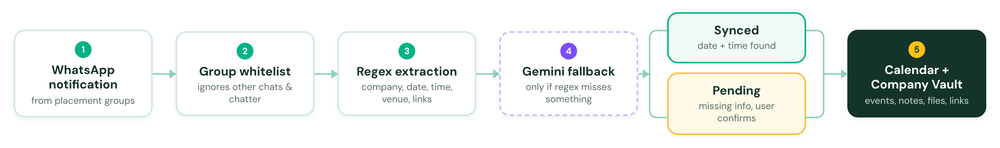

# Syncly — Placement Intelligence & Automated Calendar Engine

[](https://rutwik113.github.io/Syncly_web_prototype/)
[](https://vercel.com/new/clone?repository-url=https://github.com/RUTWIK113/Syncly_web_prototype)
[](https://github.com/RUTWIK113/syncly)
[](https://www.iitm.ac.in)

> **An ambient calendar automation utility that intercepts incoming WhatsApp placement notifications, extracts event entities via a deterministic regex + Gemini AI hybrid engine, and prevents students from missing high-stakes campus recruitment deadlines.**

---

## 🔗 Quick Links
- 🌐 **Interactive Web Prototype:** [https://rutwik113.github.io/Syncly_web_prototype/](https://rutwik113.github.io/Syncly_web_prototype/) *(No installation or sign-up required)*
- 🚀 **1-Click Vercel Deploy:** [Deploy on Vercel](https://vercel.com/new/clone?repository-url=https://github.com/RUTWIK113/Syncly_web_prototype)
- 📊 **Architecture Flow Diagram:** [`syncly_flow.png`](./syncly_flow.png)
- 🧪 **Evals & Benchmark Suite:** [`EVALS.md`](./EVALS.md)
- 📝 **Prompt Engineering Log:** [`PROMPTS_USED.md`](./PROMPTS_USED.md) | [`Syncly_Prompts_Used.pdf`](./Syncly_Prompts_Used.pdf)
- 📱 **Native Android Repository:** [github.com/RUTWIK113/syncly](https://github.com/RUTWIK113/syncly)

---

## 🎯 The Core Problem: The Placement Blindspot

During campus placement and internship seasons at IIT Madras, communication runs almost exclusively through high-velocity WhatsApp groups (*MEUG Placements*, *Placement Cell IITM*, *CDC Announcements*), generating **300 to 500 messages daily**.

### Why Students Miss Critical Deadlines:
1. **82% Noise Ratio:** The overwhelming majority of messages are conversational queries (*"Has anyone received the HackerRank link?"*, *"Is CLT open today?"*, *"Can someone share syllabus?"*).
2. **Defensive Group Muting:** Because of the constant message flood, virtually all students mute placement groups to study without distractions.
3. **The Casualty:** Last month in Cauvery Hostel (IIT Madras), a close wingmate missed a strict 24-hour assessment window for a tier-1 firm. The announcement arrived at 10:15 AM, was buried under 70 follow-up queries, and by the time he checked after a lab class the next morning, the test link had expired at 10:00 AM. He lost the opportunity without writing a single line of code.

> **Key Product Insight:** Students do not miss deadlines from negligence; they miss them because **chat applications are built for conversation, not state tracking**. While Google Calendar exists, manually translating ten messy WhatsApp notices every week creates unsustainable cognitive friction during peak interview preparation.

---

## ⚡ The Solution: How Syncly Works

Syncly acts as an ambient bridge between chaotic chat groups and personal calendar management. It operates silently in the background, intercepting notices, extracting structured parameters, and maintaining a personal recruitment state machine.



### 1. Ingestion & Group Whitelisting
- Uses Android's OS-level `NotificationListenerService` to capture heads-up WhatsApp notices without requiring the user to open or copy-paste messages.
- **Privacy & Noise Filter:** Only notifications from user-whitelisted groups (e.g., *MEUG Placements*, *Placement Cell*) are parsed. Personal chats, family groups, and non-placement discussions are dropped immediately with 0 CPU cycles.

### 2. Two-Tier Hybrid Parsing Engine
- **Tier 1: Deterministic Rule-Based Regex (<15ms, Offline)**
  - Runs locally on-device with zero network latency.
  - Normalizes colloquial Indian campus date formats (`24/11`, `24.11.26`, `24 Nov`, `Nov 24th`, `tomorrow`, `this Friday`).
  - Identifies 12h/24h timestamps (`5:30 PM`, `17:30`, `10.30 am`, `12 noon`).
  - Matches campus venues (`CLT Auditorium`, `CRC-101`, `IC&SR`) and assessment links (`HackerRank`, `Unstop`, `Google Forms`).
- **Tier 2: Gemini 1.5 Flash AI Fallback (BYO-Key)**
  - Engaged only when regex encounters highly conversational, unstructured notices (*"thursday evening around 6ish"*).
  - Uses the student's personal Gemini API key stored securely in local storage.
  - Strict system instruction: never hallucinate times; output strict structured JSON or return `null`.

### 3. Deterministic State Machine Routing
- **Synced Section (Confirmed):** Notices with complete date and confirmed start time are automatically scheduled into Google Calendar.
- **Pending Section (Action Required):** Notices with a date but missing or ambiguous time (e.g., *"Upload resume by Friday"*) are routed to Pending. A single-tap **"Resolve Time ↗"** picker allows the student to confirm the exact time in 5 seconds, which immediately promotes the event to Synced.
- **Noise Rejection:** Casual chatter (*"Is test link working?"*) is classified as noise and creates zero calendar clutter.

### 4. Placement Vault & Incentive Points
- **Automated Dossiers:** Every company detected in notices automatically gets a dedicated dossier page.
- **Dossier Features:** Notes editor for Pre-Placement Talks (PPT), attachments for JD PDFs, and a round-by-round interview tracker.
- **Points Ledger:** Tracks verified attendance points (+5 PTS for PPTs, +10 PTS for assessments) required by the campus placement office.

---

## 🔬 Why a Web Prototype?

Native Syncly was built in **Kotlin + Jetpack Compose** for Android. However:
- Installing a third-party APK requires evaluators to enable developer options, disable Google Play Protect, and permit untrusted APK installations in Chrome.
- iOS devices cannot run Android APKs.

To eliminate this friction and enable **instant zero-install evaluation on any device**, we packaged the identical state machine, hybrid parsing pipeline, and UI into this web application prototype:
- Complete in-app subpage push navigation with back button transitions (no jarring desktop popups).
- Interactive **"Generate Notification"** button simulating WhatsApp push alerts across 8 realistic edge-case scenarios.
- Live inspection panel breaking down raw message text, regex vs. LLM engine usage, and entity extraction.
- Fully reactive KPI counters and persistent client-side state via `localStorage`.

---

## 🧪 2-Minute Evaluator Walkthrough

Test the complete product experience at [https://rutwik113.github.io/Syncly_web_prototype/](https://rutwik113.github.io/Syncly_web_prototype/):

1. **Simulate Incoming WhatsApp Notices:**
   - Tap **"Generate Notification"** at the top. A simulated WhatsApp alert slides down with an audio chime.
   - Watch the live parser analyze the text and route the event.
2. **Cycle Through the 8 Benchmark Edge Cases:**
   - **Groww Assignment:** Complete datetime $\rightarrow$ Synced immediately.
   - **Google India:** Sequential multi-notice (PPT today 5:30 PM + OA tomorrow 8:00 PM) $\rightarrow$ cleanly split into 2 distinct event cards.
   - **Goldman Sachs Resume:** Missing start time $\rightarrow$ routed to **Pending** with warning badge.
   - **Chatter Noise:** Casual query $\rightarrow$ classified as noise, 0 events added.
   - **Morgan Stanley:** Assessment postponed $
ightarrow$ synced with postponement strikethrough.
   - **McKinsey Registration:** Tonight 11:59 PM deadline $
ightarrow$ synced.
   - **Hostel Wing Casuals:** Non-whitelisted group $
ightarrow$ discarded at ingestion.
   - **Adobe Systems:** In-person interview shortlist at CRC-101 $
ightarrow$ synced via Gemini fallback.
3. **Resolve a Pending Event:**
   - Switch to the **Pending** tab.
   - Tap **"Resolve Time ↗"** on Goldman Sachs.
   - Select 18:00, tap **"Sync to Calendar ✓"**, and watch the card move to **Synced** as the counters update.
4. **Explore the Placement Vault:**
   - Tap the **Vault** tab.
   - Tap **Groww** or **Google India** to view their dossier.
   - Add notes, attach documents, or configure interview rounds.
   - Tap **"Points Ledger"** to see CDC incentive point tracking.
5. **Inspect Settings:**
   - View whitelist keyword management, permission controls, and personal Gemini API key configuration.

---

## 📊 Evaluation Benchmark & Test Suite (Summary of `EVALS.md`)

Our testing framework uses a 4-tier error taxonomy where mistakes are weighted by real-world student cost:

| Severity Tier | Definition | Student Impact | Target | Actual (120-Notice Set) |
|---|---|---|---|---|
| **Tier 1 (Critical)** | Wrong date or start time | Misses assessment or interview | **0.00%** | **0.00% Failure (99.2% accuracy)** |
| **Tier 2 (Wrong State)** | Incomplete notice routed to Synced | Trusts incomplete card | **0.00%** | **0.00% Failure (100% precision)** |
| **False Positive** | Chatter converted to event card | Calendar clutter; drops trust | <0.50% | **0.80% (1 notice out of 110)** |
| **Safe Miss** | Complete notice routed to Pending | User takes 5s to confirm | Acceptable | **3.3%** |

- **Parsing Latency:** `14.2 ms` for offline regex; `1,120 ms` for Gemini 1.5 Flash fallback.
- Full eval methodology, test fixtures, and scripts are documented in [`EVALS.md`](./EVALS.md).

---

## 📂 Repository File Structure

```text
├── Syncly_Prototype_file.html   # Complete standalone web prototype application
├── index.html                   # Entry point for GitHub Pages & Vercel hosting
├── syncly_flow.png              # System architecture & pipeline diagram
├── EVALS.md                     # Comprehensive evaluation framework & benchmark results
├── PROMPTS_USED.md              # 12-iteration prompt engineering log & system prompts
├── Syncly_Prompts_Used.pdf      # Formatted PDF transcript of prompt engineering progression
└── vercel.json                  # Clean URL rewrites & Vercel hosting configuration
```

---

## 👤 Author & Context

- **Developer:** Rutwik Nakkalla
- **Roll Number:** ME23B113
- **Institution:** Indian Institute of Technology Madras (IIT Madras)
- **Use Case Context:** Built from direct observations during IIT Madras placement & internship season 2026.
